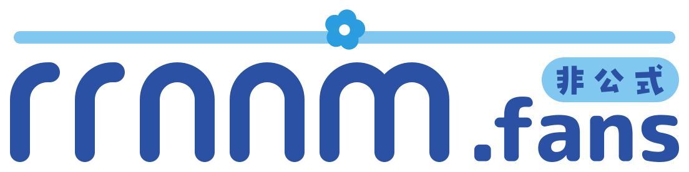

<h1 align="center">
  <a href="https://rrnnm.fans/">
    <picture>
      <source media="(prefers-color-scheme: dark)" srcset="public/logo/rrnnm-fans-logo-white-outlined.svg">
      
    </picture>
  </a>
</h1>

<a href="https://rrnnm.fans/">https://rrnnm.fans/</a>

「rrnnm.fans 瑠璃野ねも 非公式ファンサイト」のソースコードです。

> 瑠璃野ねもさんを応援する非公式サイトです。ご本人・関係者とは一切関係がありません。

瑠璃野ねもさんを知るきっかけや、ご本人の活動への橋渡しになることを目指して、個人で運営しています。

## 瑠璃野ねもさんの公式アカウント

- [YouTube](https://www.youtube.com/channel/UCnbNzG6tecF6BAdhuv_Tipg)
- [X](https://x.com/rurino_nemo)
- [マシュマロ](https://marshmallow-qa.com/rurino_nemo)
- [BOOTH](https://rurino-nemo.booth.pm)
- [Skeb](https://skeb.jp/@rurino_nemo)

## ご意見・お問い合わせ

| 内容 | 窓口 |
| --- | --- |
| 表示の崩れ・リンク切れなど、サイトの不具合 | このリポジトリの [Issues](../../issues/new/choose) |
| 「こんなページがほしい」「ここが見づらい」などのご提案 | [提案の窓口（rrnnm-fans-ideas）](https://github.com/KusatakeDotDev/rrnnm-fans-ideas) |
| 掲載内容の削除・訂正のご依頼 | 「[このサイトについて](https://rrnnm.fans/about/#contact)」のお問い合わせ先 |

Issues と提案の窓口への投稿は、誰でも見られます。削除・訂正のご依頼は、お問い合わせ先へお願いします。

Pull Request は、今のところお受けしていません。

## 技術

- [Astro](https://astro.build/) で静的なページを書き出し、[Cloudflare Workers](https://developers.cloudflare.com/workers/static-assets/)（Static Assets）で配信しています
- コンポーネントは React（`.tsx`）で書いていますが、使うのはビルドのときだけで、ブラウザには React を配っていません。同じコンポーネントを Claude Design（デザインツール）に同期して、見た目を作るためです
- トップのネモフィラ畑は、ライブラリを使わずに WebGL2 で描いています
- テストは [Vite+](https://viteplus.dev/)（Vitest）・Playwright・Storybook で、ミューテーションテストに Stryker を使っています
- JS・TS の lint は Vite+（Oxlint）、CSS の lint は Stylelint です

手元で動かす手順と、コードのコメントにある `ADR-0011` や `RRNNM-49` などの参照の意味は、[`DEVELOPMENT.md`](DEVELOPMENT.md) にあります。

## ライセンス・クレジット

このリポジトリのうち運営者が作ったもの（コードを含む）は All rights reserved です。利用・複製・改変・再配布は許諾しておらず、GitHub の利用規約が認める範囲（GitHub 上で見ることと fork すること）に限って使えます。Pull Request を送っていただいたときの扱いも [`LICENSE`](LICENSE) にあります。

All rights reserved のままリポジトリを公開しているのは、不具合の報告を受けるためと、CI を GitHub Actions の標準のランナーで無料で回すためです。

作品からの引用や作品名、各サービスのロゴやフォントなど、ほかの人の著作物は、それぞれの権利者のものです。ロゴとフォントのファイルと条件は [`LICENSE`](LICENSE) の末尾にあります。

トップのネモフィラ畑の花には、トキワ雑貨店さんの [「ネモフィラ」【3Dモデル】](https://booth.pm/ja/items/3991171) を使わせていただいています。
